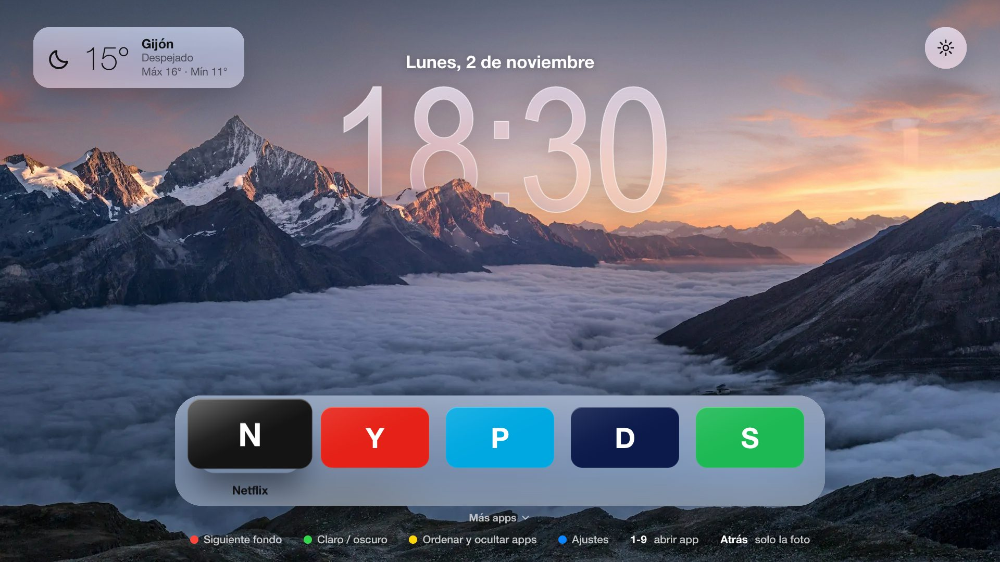
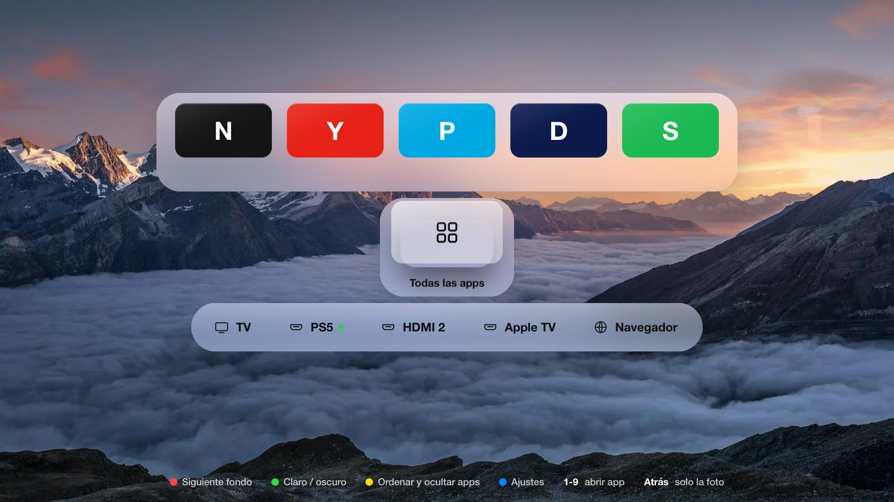
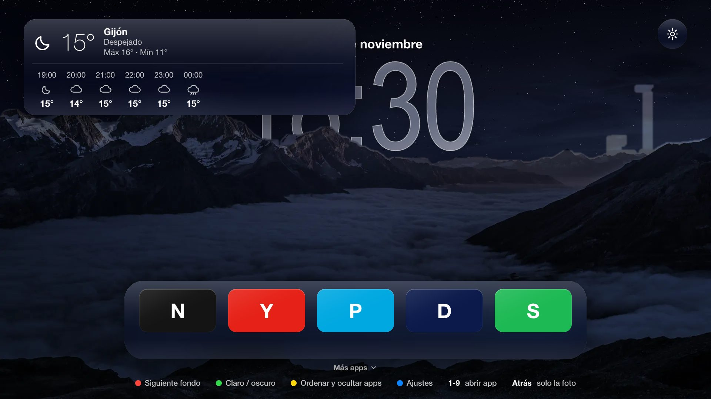
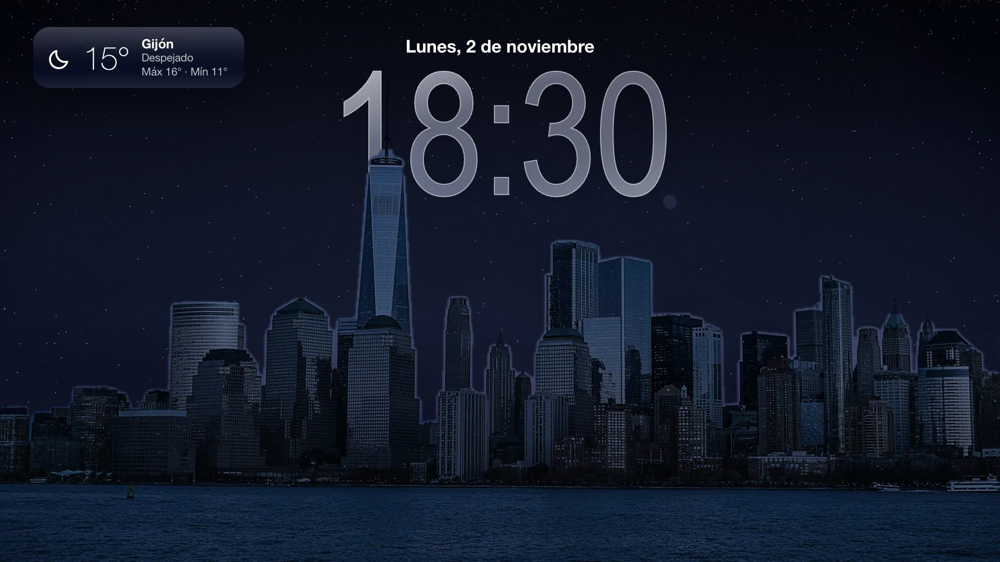

<div align="center">

# 📺 TV Libre

**Una pantalla de inicio rápida, limpia y sin anuncios para televisores LG con webOS, con estética de Apple TV.**




</div>

Ni banners, ni filas patrocinadas, ni vídeos que se reproducen solos: una foto bonita, la hora, el tiempo y tus apps. Funciona en la LG **UN711C0ZB** (webOS 5.0) y debería hacerlo en cualquier LG con webOS 4 o 5. No toca el sistema: el inicio de LG sigue donde estaba y se desinstala con una orden.

<table>
  <tr>
    <td width="33%"></td>
    <td width="33%"></td>
    <td width="33%"></td>
  </tr>
  <tr>
    <td align="center"><sub><b>Más apps</b> · bajando aparecen el resto y las entradas</sub></td>
    <td align="center"><sub><b>De noche</b> · el cielo se llena de estrellas</sub></td>
    <td align="center"><sub><b>Modo marco</b> · solo la foto y el reloj</sub></td>
  </tr>
</table>

## ✨ Qué tiene

### 🖼️ Bonita

- **Vidrio líquido.** Las cajas de apps, los ajustes, los avisos y hasta las cifras del reloj son vidrio que difumina el fondo, con canto de luz y reflejo.
- **38 fondos.** 5 degradados minimalistas y 33 fotos de montañas, playas, ciudades, lagos y naturaleza. Van dentro del paquete y funcionan sin red.
- **Rotación difuminada.** El fondo cambia solo (cada 1, 5, 15 o 60 minutos): la foto se desenfoca, cambia y la nueva se asienta, como en Apple TV.
- **Reloj con profundidad.** En 10 fotos, las cumbres o los edificios tapan parte del reloj, como en la pantalla de bloqueo del iPhone.
- **Día y noche.** El verde del mando cambia entre claro y oscuro, o lo hace solo con el amanecer y el anochecer de tu ciudad. De noche, las fotos pasan a su versión nocturna: cielo con estrellas y luz de luna.
- **Modo marco y salvapantallas.** Atrás, o unos minutos sin tocar el mando, deja solo la foto y el reloj.

### 📱 Tus apps, a mano

- **Solo tus favoritas delante**, abajo, para que se vea el fondo. Bajando, la pantalla se desliza y aparecen el resto (con *Todas las apps* al final) y las entradas.
- **Ordenar y ocultar con el mando.** Amarillo: ◀ ▶ mueve, ▲ ▼ pasa de favoritas al resto, OK oculta. Cada caja mide lo que sus apps.
- **Entradas a un botón.** TV, cada HDMI con el nombre que le pusiste en la TV ("PS5") y el navegador.
- **Seguir viendo.** Al volver a TV Libre, el foco está en lo último que abriste. Del 1 al 9, la app de ese puesto.

### 🌦️ Tu día de un vistazo

- **El tiempo** de tu ciudad con [Open-Meteo](https://open-meteo.com) (sin clave y sin rastreo). Enfocado, se despliega con las próximas 6 horas.
- **Aviso de lluvia.** Si va a llover pronto, la tarjeta late en azul y dice a qué hora.
- **Calendario.** Junto a la fecha, lo siguiente que tienes hoy ("· 18:30 Fútbol"). Elige la fecha con el mando y verás tus próximos 7 días.
- **Despertador.** A la hora que elijas, TV Libre abre con el reloj grande y el resumen del día: tiempo, lluvia y lo que tienes en el calendario.

### 🪶 Ligera con la TV

- Solo se animan `transform` y `opacity`, y la repetición de teclas se limita para que no se acumule lag.
- Ningún difuminado se calcula en la TV: cada foto trae su copia ya difuminada. Nunca hay dos fotos a pantalla completa en memoria.
- Mientras usas otra app, TV Libre suelta la foto de la memoria (la TV solo tiene 1 GB) y la recupera al volver.
- **Atenuado de noche**, solo en TV Libre o en toda la TV (bajando su retroiluminación de 22:00 a 7:00, si el firmware lo permite).

### 🎮 Y además

- **[Apps de mando para Android e iPhone](movil/README.md)** con trackpad, teclado, búsqueda directa en YouTube, apps, cambio de fondo y un botón Home que abre TV Libre (y no el inicio de LG).
- **[Guía de ajustes de la TV](docs/AJUSTES-TV.md)** para quitar publicidad y procesos de fondo desde los menús, y una **[lista DNS](dns/bloqueo-lg.txt)** para Pi-hole o AdGuard Home.

## 🚀 Instalar

Unos diez minutos. Necesitas la TV y un ordenador en la misma red, con Python 3. Nada más.

1. **En la TV:** abre LG Content Store e instala **Developer Mode**. Entra con una cuenta gratuita de [LG Developer](https://webostv.developer.lge.com), activa **Dev Mode Status** (la TV se reinicia) y después **Key Server**. Apunta la IP y la frase de paso que aparecen.
2. **En el ordenador:**
   ```bash
   python3 tools/install.py 192.168.1.50
   ```
   Con la IP de tu TV. La primera vez pide la frase de paso y empareja la TV; las siguientes no pide nada (y basta con `python3 tools/install.py` si solo tienes una TV).
3. **En la TV**, con TV Libre abierta, **mantén pulsado un número del mando** para guardarla en el Acceso rápido. Ese número la abre desde cualquier sitio.

Para que la TV no vaya al inicio de LG al encenderla: *Ajustes → General → Ajustes adicionales → Ajustes de la pantalla de inicio → Inicio automático de Home: desactivado*.

<details>
<summary><b>📅 Añadir tu calendario</b></summary>

En Google Calendar (en el ordenador): *Configuración → tu calendario → Integrar el calendario → Dirección secreta en formato iCal*. Cópiala y ejecuta:

```bash
python3 tools/install.py --calendario='https://calendar.google.com/calendar/ical/…/private-…/basic.ics'
```

El enlace se guarda en `app/calendario.txt`, que no entra en git: quien lo tenga puede leer tu calendario. Si alguna vez se filtra, en Google Calendar puedes restablecerlo. Con `--calendario=` (vacío) se quita.
</details>

<details>
<summary><b>🔐 Sobre la clave SSH de la TV</b></summary>

La clave se guarda **desbloqueada** en `~/.ssh/tvlibre_<IP>` (permisos 600) para no pedir la frase en cada actualización. Es un compromiso de comodidad: quien pueda leer tu `~/.ssh` podría entrar al modo desarrollador de la TV. Bórrala con `--olvidar` cuando no la necesites.

La primera conexión guarda la huella de la TV en `~/.ssh/tvlibre_known_hosts` y las siguientes se niegan a seguir si cambia. Activa el Key Server solo mientras emparejas: sirve la clave por HTTP.
</details>

## 🎛️ El mando

| Botón | Qué hace |
|---|---|
| ◀ ▶ ▲ ▼ | Moverse (▼ desde las favoritas: más apps y entradas) |
| OK | Abrir la app o entrada · sobre la fecha, el calendario · sobre el tiempo, las próximas horas |
| OK mantenido | Coger la app para moverla, como en tvOS |
| 1 – 9 | Abrir la app de ese puesto |
| Atrás | Modo marco: solo la foto y el reloj |
| 🔴 Rojo | Siguiente fondo |
| 🟢 Verde | Claro / oscuro |
| 🟡 Amarillo | Ordenar y ocultar apps (en *Todas las apps*, ocultar o volver a mostrar) |
| 🔵 Azul | Ajustes |

En **Ajustes** están el tema, el fondo y su rotación, el cielo de noche, el reloj, la profundidad, la fecha, el tiempo y la ubicación, el despertador, el atenuado, el salvapantallas, el vidrio y las animaciones.

> **¿La TV va lenta?** Pon *Vidrio: Sencillo* y *Animaciones: Reducidas*. Si va igual de lenta en el inicio de LG, es la TV: con 1 GB de memoria, las apps tardan en abrir hagas lo que hagas. La [guía de ajustes](docs/AJUSTES-TV.md) ayuda a liberar memoria.

## 🔧 Mantenimiento

- **Developer Mode caduca a las 1000 horas (~40 días).** Abre la app Developer Mode de vez en cuando y pulsa **EXTEND**. TV Libre te lo recuerda a los 30 días, y en *Ajustes → Developer Mode* la abres directamente. Si caduca, TV Libre desaparece: basta con volver a instalarla.
- **Desinstalar:** `python3 tools/install.py --desinstalar`
- **Si reinstalas Developer Mode**, la huella SSH de la TV cambia y el instalador se detiene: `python3 tools/install.py 192.168.1.50 --olvidar` y vuelve a emparejar.

## 🛠️ Desarrollar

```
app/                 la app web (HTML, CSS y JS, sin dependencias)
  js/app.js          navegación con el mando, apps, ajustes, tema, despertador
  js/fondos.js       lista de fondos, transición difuminada, profundidad y vidrio
  js/tiempo.js       Open-Meteo, iconos y aviso de lluvia
  js/calendario.js   lee tu calendario (.ics), con los eventos que se repiten
  js/luna.js         llamadas al bus Luna de webOS; datos de ejemplo fuera de la TV
  js/ssap.js         el protocolo de la TV, por si el firmware no deja usar Luna
  fondos/            cada foto, su copia difuminada, su primer plano y su versión de noche
movil/               apps de mando para Android (Kotlin) e iOS (SwiftUI)
tools/build.py       crea TVLibre.ipk sin las herramientas de LG
tools/install.py     instala por SSH con el instalador de la propia TV
tools/fondos.py      descarga las fotos y crea sus copias de vidrio (Pillow)
tools/profundidad.py recorta el primer plano de las fotos con profundidad (Pillow, NumPy, SciPy)
tools/noche.py       crea la versión de noche de cada foto (Pillow, NumPy)
```

**Probar en el ordenador:** `python3 -m http.server 8123 --directory app` y abre http://localhost:8123 a 1920 × 1080. Sin la TV salen apps de ejemplo. Las flechas y Enter hacen de mando; `R`, `G`, `A` y `S` son los botones de colores y `Esc`, Atrás.

<details>
<summary><b>Límites de webOS 5 y cómo se esquivan</b></summary>

Su navegador es Chromium 68: nada de `backdrop-filter`, `gap` en flexbox, `?.` ni `??`. El JS está escrito en ES2015.

El vidrio no usa `backdrop-filter`: cada foto trae una copia de 480 × 270 ya difuminada (`-vidrio.jpg`) que cada panel recorta en su sitio, y el reloj la usa de relleno. La transición entre fondos se hace con esa misma copia, así que nunca hay dos fotos de 1920 × 1080 en memoria.

La versión de noche se prepara en el ordenador (`tools/noche.py`): en las fotos con profundidad, el recorte del primer plano dice qué píxeles son cielo, y ese cielo se cambia por uno estrellado.
</details>

<details>
<summary><b>Añadir fotos</b></summary>

1. Pon la entrada en `LISTA` de `app/js/fondos.js`, con el id de Unsplash, y ejecuta `python3 tools/fondos.py`.
2. Si quieres profundidad, márcala con `profundidad: true` (y `relojY` para bajar el reloj) y revisa el recorte con `python3 tools/profundidad.py --muestra`.
3. `python3 tools/noche.py --muestra` crea su versión de noche. Si ya es de noche, márcala con `nocturna: true` (y con `dia: true` si su cielo es liso y quieres versión de día).
</details>

<details>
<summary><b>Con las herramientas oficiales de LG</b></summary>

```bash
npm install -g @webos-tools/cli
ares-setup-device   # añade la TV
ares-package app && ares-install com.tvlibre.inicio_0.4.0_all.ipk
```
</details>

## ✅ Compatibilidad

| TV | Estado |
|---|---|
| LG UN711C0ZB · webOS 5.0 · 04.64.00 | ✅ instalar, listar y abrir apps, mando, entradas, tiempo, calendario · ⏳ atenuado de toda la TV |
| Navegador de escritorio a 1920 × 1080 (apps de ejemplo) | ✅ |
| Otras LG con webOS 4 o 5 | ❓ sin probar |

Si la pruebas en otra TV, cuenta el modelo, la versión de webOS y qué funciona.

## 🙏 Créditos

Idea inspirada en [Free My TV](https://github.com/simbasjungles/free-my-tv) (MIT). El cielo de la profundidad, en el método de [couch-tv](https://github.com/Seagey/couch-tv). Fotos de [Unsplash](https://unsplash.com) (licencia de Unsplash). Código con licencia [MIT](LICENSE).
